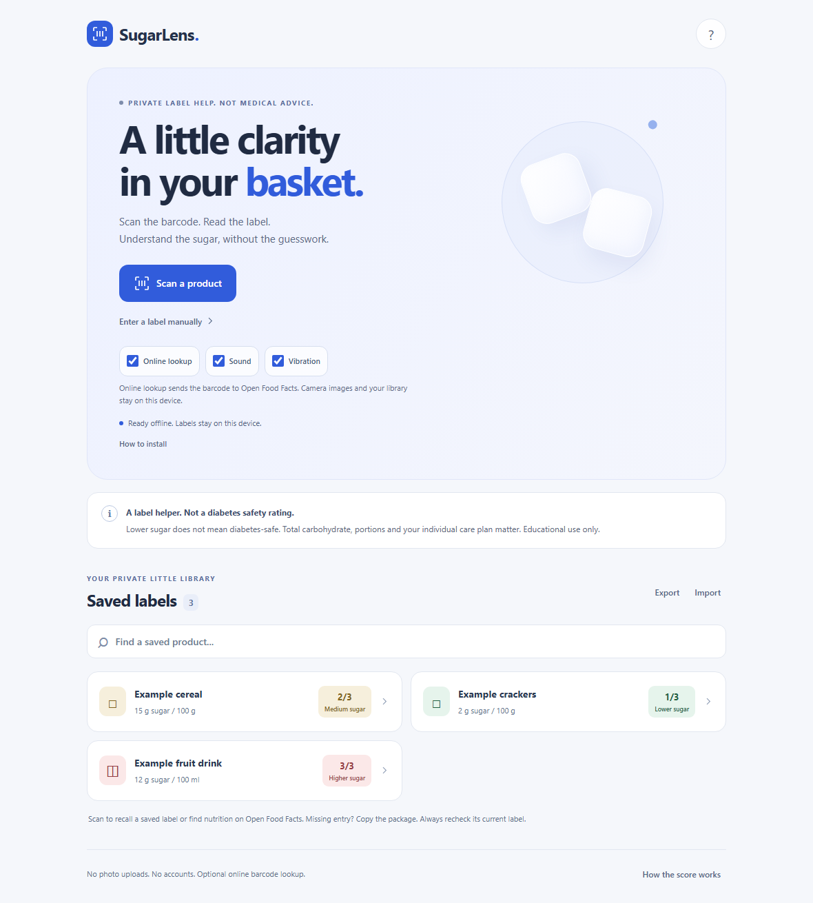
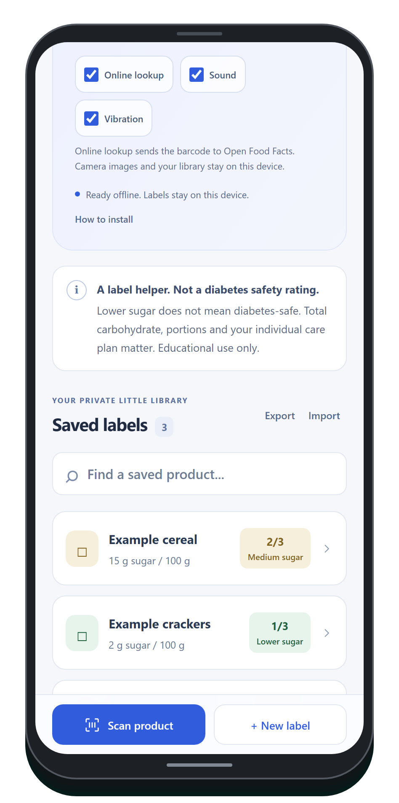
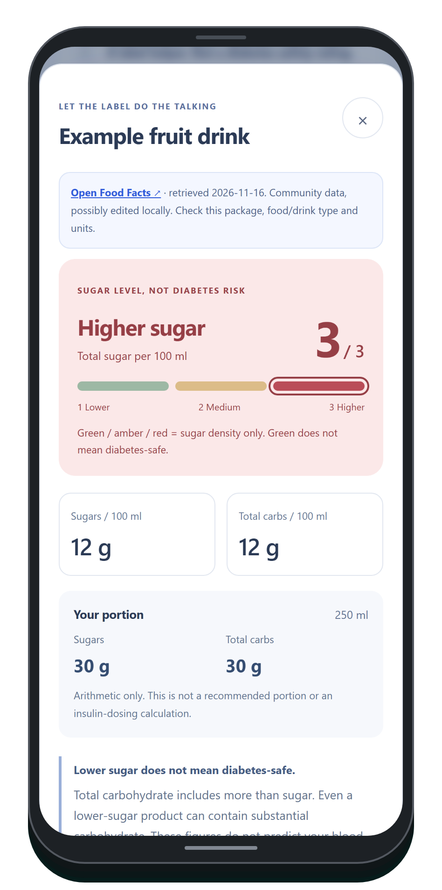

<div align="center">

# SugarLens

### A little clarity in your basket.

A minimal, phone-first food-label helper. Scan supermarket products, understand
their sugar density, and keep your label library entirely on your device.

[Open SugarLens](https://edoardorex.github.io/sugarlens/) ·
[How it works](#scan-read-understand) ·
[Mobile previews](#optimized-for-mobile) ·
[Medical limitations](#important-medical-limitations) ·
[Online lookup & privacy](#local-library-optional-online-lookup)

</div>

---



*Illustrative sample labels, not product recommendations.*

> **Educational label-reading help only. Not medical advice or a diabetes safety
> rating.** A lower sugar score does not mean a product is safe for diabetes.
> Do not use SugarLens for diagnosis, glucose prediction, insulin dosing,
> treating a hypo, emergencies, or changing medication or your care plan.

## Scan. Read. Understand.

1. **Scan the package barcode** with your phone camera, or enter a label manually.
2. **Find nutrition automatically on Open Food Facts.** New barcodes trigger an
   online lookup when enabled. Choose food or drink and review the retrieved
   per-100 values against the actual package. Missing or invalid data? Enter
   the label manually instead.
3. **See a green, amber or red sugar-density score**, plus total carbohydrate and
   your optional portion amounts. Gentle sound and vibration confirm scans and
   scores. Save the label locally for next time.

Future scans recall your own saved entry. Recipes and nutrition labels can change:
**always recheck the current package**, especially when recalling or importing data.

| Small, useful, private | What it does |
| --- | --- |
| **On-device camera scanning** | EAN-13, EAN-8, UPC-A, and supported GTIN-bearing GS1 Data Matrix / Code 128 |
| **Automatic nutrition lookup** | Open Food Facts values, product attribution and retrieval date; review before scoring |
| **A transparent color score** | Green / amber / red, with numbers and text, separate food and drink thresholds |
| **A little sensory feedback** | Gentle scan confirmation and one/two/three score pulses; independent sound and vibration switches |
| **Carbohydrate context** | Total carbohydrate is separate from sugar and never guessed when missing |
| **Portion arithmetic** | Optional grams of sugar and carbohydrate for the amount you enter |
| **Per-serving labels** | Converts to per 100 g/ml when labelled serving weight or volume is known |
| **Private label library** | Local browser storage, search, editing, JSON export and restore |
| **Installable and offline** | Home-screen support; app and scanner assets cached after the first online visit |
| **Comfortable on small screens** | Reachable scan/add bar, full-width sheets, large inputs, and 320px layouts |

English interface, local number formatting, decimal dot or comma entry.
No account, API key, subscription, analytics, external fonts, or backend.
Online catalogue lookup is optional; your saved label library stays local.

## Optimized for mobile

On your phone, the bottom bar keeps **Scan product** and **New label** within
reach. Forms and results open in a full-width sheet; inputs avoid automatic
mobile zoom, and smaller screens stack label fields instead of squeezing them.

Sheets adjust to the visible screen when the keyboard opens, without scrolling
the page behind them. Closing a changed label asks before discarding unsaved
details or results. Saving clears an old library search so the new entry stays
visible. Once labels are saved, a shorter phone header brings the library closer
without hiding the medical limitations.

**Online lookup**, **Sound** and **Vibration** switches are within reach on the
home screen and remembered on this device. New scans find nutrition online;
saved barcodes recall your own label without a request. You can cancel a slow
lookup and enter the package values immediately. Confirm food or drink yourself:
catalogue categories and serving conventions are not always reliable.

Sound is unlocked by a tap, not played on page load. Scans give a gentle
confirmation; scores give one, two or three short pulses matching the band
number, **not a medical alarm**. Vibration requires browser and device support:
**iPhone Safari does not support web vibration**. Unsupported controls are
disabled and explained; browser restrictions or silent settings may suppress
feedback. Color, score numbers and text always remain available.

<p align="center">
  <a href="docs/screenshots/phone-library.png"></a>
  <a href="docs/screenshots/phone-sugar-result.png"></a>
</p>

*Your label library and a color sugar-density result. Phone-sized app screenshots
in a generic smartphone frame; illustrative labels and catalogue response, not
product recommendations.*

Tap either preview to open the full-size image.

## What the score actually means

The score is **an ordinal sugar-density band**, not a percentage or clinical score.
Higher numbers mean more total sugar per 100 g of food or 100 ml of drink:

| Score | Meaning | Food / 100 g | Drink / 100 ml |
| --- | --- | --- | --- |
| **1 / 3** | Lower sugar | ≤ 5 g | ≤ 2.5 g |
| **2 / 3** | Medium sugar | > 5 to 22.5 g | > 2.5 to 11.25 g |
| **3 / 3** | Higher sugar | > 22.5 g | > 11.25 g |

These are the **per-100 sugar criteria** from UK nutrition-label guidance.
The full front-of-pack scheme also considers portion criteria and other nutrients;
SugarLens does not implement that entire scheme. It is not Nutri-Score or an
overall health rating. Display rounding does not change the underlying band.

The app uses **total sugars**, not added/free sugars. Naturally occurring sugars
and added sugars are not distinguished by this score. Enter **total carbohydrate**,
not "net carbs", on the same label basis. Missing carbohydrate or portion values
remain unknown; they are never silently treated as zero.

For a per-serving label:

```text
Sugar per 100 g/ml = labelled sugar grams / labelled serving g/ml × 100
Sugar in your portion = labelled sugar grams / labelled serving g/ml × your portion g/ml
```

The same arithmetic is used for total carbohydrate. Your entered portion is
**not a recommended serving** and the calculation is **not for insulin dosing**.

## Important medical limitations

SugarLens deliberately does **not** give a "safe", "dangerous", or personalised
diabetes rating. Such a claim would be misleading from sugar data alone.

- Starch and other carbohydrates also matter. A lower-sugar product can contain
  substantial carbohydrate.
- Fibre, sugar alcohols, food preparation, portion size, activity, medication,
  and individual response affect interpretation. Labelling conventions vary
  by country.
- The app does not estimate glycaemic index/load, predict blood-glucose changes,
  account for your medical history, or determine suitability for any diabetes type.
- A higher-sugar food is not categorically forbidden. For example, fast-acting
  carbohydrate may be part of an existing clinician-provided hypo plan.
  **Never override your care plan with this score.**
- Manual inputs and community catalogue data may be mistaken, incomplete, rounded,
  stale, or inconsistent. Use the current package
  and verify units; cups, pieces and ounces need a reliable package-provided
  conversion to grams/millilitres.
- If you need personalised guidance, ask your clinician or registered dietitian.
  Follow your existing emergency instructions when unwell; this is not an
  emergency or treatment tool.

Warnings appear on the home screen, every result, and in the in-app guide.
The app makes no claim of clinical validation or medical-device approval.

## Local library, optional online lookup

**Online lookup is enabled by default.** Scanning an unsaved barcode or tapping
**Find nutrition online** sends the barcode to
[Open Food Facts](https://world.openfoodfacts.org/). It also receives ordinary
request metadata, including your IP address and browser information.
**Camera frames, your saved library, portions and health information are never
sent.** Requests omit cookies and referrers. No product photos are fetched.

Turn off **Online lookup** for local-only scanning and manual label entry.
Saved barcodes always recall your local record first, even when online; they
are not silently refreshed or overwritten. Manual entry never starts a lookup
unless you tap its lookup button. There is no OCR.

Lookup uses the Open Food Facts v3 product endpoint, not a search-as-you-type API.
Only reported **total sugars and total carbohydrate per 100 g/ml** are used;
estimated, added-sugar and prepared-only values are not substituted. Missing
carbohydrate remains unknown; missing sugar, invalid nutrition, a mismatched
barcode, missing products, API limits, network failures and a 10-second timeout
all leave manual entry available with a visible explanation. Your portion is
never inferred. Catalogue categories only suggest food/drink; you must select
the correct type before scoring.

The app limits lookup attempts to 15 per minute per tab. Provider/IP-wide limits
may still apply. No automatic retries or bulk requests are made.

The static app is initially downloaded from its hosting origin. A service worker
precaches its own files, including the lazy-loaded scanner, then the app works
offline for saved scans and manual labels. **New online lookups require internet.**
Wait for **Ready offline** before disconnecting. Hosting providers still
handle ordinary requests for app assets. Source links open external websites only
when you choose to click them.

Products are stored in `localStorage`, scoped to the browser profile and origin.
Data is **not encrypted**; anyone using that profile can read it. No automatic
sync between devices. Clearing site data, private browsing, or browser storage
eviction can remove your library, preferences or offline cache. Keep private JSON backups.
The app reports failed saves and protects unreadable storage from silent overwrite.

The service worker deletes only its own `sugarlens-` caches, not other apps' caches.

## Put it on your phone

Open [SugarLens](https://edoardorex.github.io/sugarlens/) online once and wait for
**Ready offline**.

- **iPhone / iPad, Safari:** Share → Add to Home Screen.
- **Android, Chrome:** browser menu → Install app / Add to Home screen, or use the
  in-app install button when offered.

Installation is optional. Camera access needs HTTPS or localhost, browser support,
and permission. A laptop webcam also works. If permission is denied or the code
will not read, manual label entry remains available. Closing the camera or
backgrounding the app releases its video tracks.

This release supports retail EAN/UPC/GTIN check digits; arbitrary QR codes and
UPC-E are not supported. Product codes are normalised to GTIN-14 for local recall.

## Run locally

Node.js 22.12+ and npm:

```sh
git clone https://github.com/edoardorex/sugarlens.git
cd sugarlens
npm ci
npm run dev
```

Use the localhost URL printed by Vite, not a `file://` page. For offline testing,
use a production build:

```sh
npm run lint
npm test
npx playwright install chromium
npm run test:e2e
npm run build
npm run preview
```

Browser tests use the production build to cover the actual service worker and
offline scanner. They also check mobile and desktop accessibility, barcode camera
decoding, persistence, missing nutrients, misleading inputs and safe text rendering.

For a phone on your network, use a properly configured HTTPS static server;
plain LAN HTTP is not a secure camera/service-worker context.

## Static publishing

The live app is served from the **`gh-pages` branch**, configured in
Settings → Pages → Deploy from a branch → `gh-pages` → `/ (root)`.

Build with `npm run build -- --base=/sugarlens/` and publish the contents of
`dist/` to that branch, keeping `.nojekyll` at its root. Other static hosts can
serve `dist/` after `npm run build`. Adjust the base path for other subdirectories.

New service workers wait rather than abruptly replacing an open app. Use
**Update available** to reload when ready; unsaved label edits require confirmation.

## Sources

Thresholds and explanatory sources, checked on 16 November 2026:

- [NHS: how to read food labels](https://www.nhs.uk/live-well/eat-well/food-guidelines-and-food-labels/how-to-read-food-labels/)
- [UK government: front-of-pack nutrition labelling guidance](https://www.gov.uk/government/publications/front-of-pack-nutrition-labelling-guidance)
- [Diabetes UK: food, carbohydrates and individual care in type 1 diabetes](https://www.diabetes.org.uk/living-with-diabetes/eating/i-have-type-1-diabetes)
- [Open Food Facts: API documentation and usage guidelines](https://openfoodfacts.github.io/openfoodfacts-server/api/)

These organisations do not endorse SugarLens. The in-app explanations are
available offline; linked original documents need internet access.

## Tiny by design

Vanilla JavaScript, Vite, ZXing, and a small build-generated service worker.
No UI framework or server. Optional direct catalogue requests; no image uploads.

```text
src/
  domain.js           Input validation, barcode identity, sugar bands, portion maths
  storage.js          Private local label library
  lookup.js           Validated Open Food Facts lookup, cancellation and timeout
  feedback.js         Tap-unlocked sound and optional vibration
  scanner.js          On-device decoding
  offline.js          Install and update lifecycle
  service-worker.js   Build-time precache template
  main.js             Phone-first interface
  style.css           A little calm, with clear color bands
```

**Code: MIT. Catalogue data: separate open-data licenses.** Open Food Facts data
is provided under [ODbL](https://opendatacommons.org/licenses/odbl/1.0/) and
[Database Contents License](https://opendatacommons.org/licenses/dbcl/1.0/).
Imported records and JSON backups retain provider attribution and retrieval
dates. If you redistribute catalogue data, follow its attribution and share-alike
requirements; the code license does not relicense that data.

Deployers should review the provider's API usage guidelines and register their
application through its linked usage form. Browser JavaScript cannot reliably
set a custom User-Agent; requests identify the app with `app_name=SugarLens`.
Automated tests use mocked responses, not repeated production API queries.

Built for everyday clarity, not medical decisions.
